# ainolez — Product Plan, DFD, UML & Database Design (v2)

> **Status:** planning only, no application code yet.
> **Brand:** ainolez · **Slogan:** *Learn it. Code it. Own it.*
> **Model:** 100% free learning platform with no purchases, plans, or paywalls.

---

## 0. Context
ainolez is a free platform for learning coding and skills, combining:
- **W3Schools strengths:** short readable tutorials, "Try it Yourself" editor, references, exercises, quizzes.
- **DataCamp strengths:** structured courses, a progress dashboard, points, and certificates.
- **Additions:** an AI tutor chatbot, a community, gamification, and auto-issued shareable certificates.

**Three faces:**
1. Public website.
2. Learner portal.
3. Super Admin control panel.

**Stack:**
- Frontend: React + HTML/CSS/JS.
- Backend: Python, designed as a **modular monolith**.
- Database: MySQL.
- Hosting: a **cPanel Linux** server.

---

## 1. Brand Identity

### 1.1 Logo (uses the name "ainolez" only)
- **Wordmark:** lowercase `ainolez` in Poppins SemiBold (600).
  - **The dot of the "i" is a neon-green square cursor**, the blinking cursor of a code editor. It means "you are writing your future".
  - **The "o" is a ring in W3 green**, like a progress ring that is almost complete. It means learning progress.
- **Icon / favicon:** a navy rounded square with a lowercase `a` and the green cursor square beside it.
  - Used for the app icon, favicon, social avatar, and certificate seal.
- **Variants:**
  - Full colour on light backgrounds.
  - Reversed (white + neon) on navy.
  - Single colour (navy) for print.
  - Icon only.
- **Clear space:** at least the height of the cursor square on every side. **Minimum size:** 24 px for the icon, 96 px wide for the wordmark.
- **Deliverables (Sprint 1):** `logo-full.svg`, `logo-reversed.svg`, `logo-mono.svg`, `icon.svg`, `favicon.ico`, `og-default.png` (1200×630).

### 1.2 Slogan
- **Primary:** **"Learn it. Code it. Own it."**
- **Supporting line (hero / SEO):** "Free coding and AI courses, a live code editor, and an AI tutor, for everyone."
- **Alternates:** "Code your future, free." · "Where curious minds learn to code."

### 1.3 Colour tokens (W3Schools × DataCamp)
| Token | Hex | Use |
|---|---|---|
| `--navy-900` | `#05192D` | Header, footer, admin sidebar, logo text (DataCamp navy) |
| `--ink-800` | `#282A35` | Code blocks, topic bar (W3Schools dark) |
| `--green-600` | `#04AA6D` | Primary buttons, links, the "o" ring (W3Schools green) |
| `--green-400` | `#03EF62` | Cursor dot, progress bars, highlights (DataCamp neon) |
| `--yellow-100` | `#FFF4A3` | "Example" boxes (W3Schools) |
| `--sky-100` | `#E7F0FF` | Info callouts |
| `--gray-50` | `#F5F7FA` | Page background |
| `--text-900` | `#1F2933` | Body text |
| `--amber-500` | `#F5A524` | Points and badges |

**Fonts:** Poppins (headings), Inter (body), JetBrains Mono (code).

---

## 2. Tech Stack

| Layer | Choice |
|---|---|
| Frontend | React 18 + Vite, React Router, plain CSS (CSS Modules + tokens), JavaScript, CodeMirror 6 |
| In-browser runners | HTML/CSS/JS run in a sandboxed `<iframe>`. Python runs in **Pyodide**, SQL in **sql.js**, both loaded from the jsDelivr CDN |
| Backend | Python 3.11, **Django 5 + Django REST Framework**, SimpleJWT |
| AI | **Anthropic Claude API** (official `anthropic` Python SDK). Default model `claude-opus-5-5`. The admin can switch to `claude-sonnet-5-5` or `claude-haiku-5-5` to save cost |
| Markdown | python-markdown + extensions (fenced code, tables, toc, admonition) + custom ainolez shortcodes, sanitised with bleach |
| Database | MySQL 8 / MariaDB 10.6+, InnoDB, utf8mb4 (driver `mysqlclient`, or `PyMySQL` as a fallback) |
| Images / PDF | Pillow (social share image), reportlab (certificate PDF) |
| Background jobs | **Database-backed job queue + cPanel cron**. Shared hosting has no Redis or Celery |
| Cache | Django database cache table, or file cache |
| Quality | ruff + black + isort, import-linter (module boundaries), pytest-django, Vitest, ESLint + Prettier |

---

## 3. Architecture: Modular Monolith

**One deployable Django project, split into strict modules (bounded contexts).** Each module owns its own models and tables. Other modules may use it **only** through its public `services.py` / `selectors.py`, or by reacting to the **domain events** it publishes. Nobody imports another module's models directly. `import-linter` enforces this in CI.

```
backend/
  config/                  settings (base, local, production), urls, passenger_wsgi.py
  shared/                  shared kernel: BaseModel, soft delete, status, permissions,
                           pagination, event bus, audit, exceptions, utils
  modules/
    identity/              users, roles, auth tokens, profiles
    catalog/               categories, courses, chapters, lessons, lesson blocks, code examples
    content_tools/         md→html converter, shortcodes, video embeds, sanitiser
    media/                 media library, uploads, image resize
    assessment/            exercises, quizzes, questions, options, grading
    learning/              enrolments, lesson progress, resume, learning paths
    gamification/          points rules, points ledger, badges, streaks, leaderboard
    certification/         templates, auto issue, PDF/OG image, verify, share links
    community/             spaces, posts, replies, lesson comments, reactions, reports, moderation
    assistant/             AI chatbot, knowledge base, indexing, admin AI settings, usage
    ai_authoring/          AI course generator (drafts for admin review)
    notifications/         email + in-app notifications
    platform_admin/        dashboard stats, site settings, audit log, trash bin, jobs
```

**Inside every module (same layout everywhere):**
```
modules/<name>/
  models.py        tables owned by this module only
  services.py      write use cases (create_course, publish_lesson ...) — public API
  selectors.py     read queries — public API
  events.py        events this module publishes (LessonPublished, CourseCompleted ...)
  handlers.py      reactions to other modules' events
  api/             serializers.py, views.py, urls.py, permissions.py
  admin_api/       admin-only endpoints
  tasks.py         background jobs
  tests/
```

**Example event flow:**
1. `learning` publishes `CourseCompleted`.
2. `certification.handlers` issues the certificate.
3. `gamification.handlers` adds +200 points.
4. `notifications.handlers` emails the learner.

`learning` knows nothing about the other three modules.

**Frontend mirrors the modules:**
```
frontend/src/
  app/ (router, providers, guards)  shared/ (ui kit, tokens.css, api client, hooks)
  features/ catalog | lesson | playground | assessment | learning | gamification
            certificates | community | assistant | auth | admin/*
```

**Clean-code rules (once coding starts):**
- Names describe intent; Python functions stay under 40 lines.
- Type hints and docstrings on every public service.
- No business logic in views or serializers; it lives in services.
- One React component per file; data fetching goes in hooks (`useCourse`, `useProgress`).
- Every module has unit tests for its services.
- Conventional commits; PRs need lint and tests to pass.

---

## 4. Universal Record Controls (item 13)

**Every manageable entity offers:** Create · Edit · **Active/Inactive** · **Soft delete** · **Restore** · **Hard delete**. This covers categories, courses, chapters, lessons, blocks, examples, exercises, quizzes, questions, options, media, comments, posts, badges, point rules, certificates, AI knowledge sources, FAQ entries, users, and settings.

| Action | Behaviour |
|---|---|
| Create / Edit | Form with validation; `created_by` / `updated_by` set automatically; audit log entry |
| Active / Inactive | `is_active` toggle. Inactive items are hidden from public and learners but stay editable for admins |
| Soft delete | Sets `deleted_at` and `deleted_by`, and `alive = NULL`. The item moves to the **Trash** page and disappears everywhere else |
| Restore | From Trash. Clears `deleted_at` and sets `alive = 1` |
| Hard delete | **Super Admin only**, from Trash only. A preview lists the child records that would also be removed, and the admin must type the item name to confirm. The deletion is permanent and audit-logged. Physical files are removed by a job |
| Bulk actions | Activate, deactivate, soft delete, and restore many rows at once |

**Shared base model (`shared/models.py`):**
`id`, `created_at`, `updated_at`, `created_by`, `updated_by`, `is_active`, `deleted_at`, `deleted_by`, `alive`.
- The default manager hides deleted rows. `all_objects` includes them.
- **Unique slugs with soft delete:** `alive` is `1` when live and `NULL` when deleted. The constraint `UNIQUE(slug, alive)` allows reuse of a deleted slug, because MySQL allows multiple NULLs.

---

## 5. Roles & Features

| Feature | Visitor | Learner | Super Admin |
|---|:-:|:-:|:-:|
| Read tutorials, references, examples; Try-it editor; search | ✅ | ✅ | ✅ |
| AI tutor chat | limited (e.g. 5/day) | ✅ (daily limit set by admin) | ✅ |
| Register / login / verify / reset password | ✅ | – | – |
| Enrol, save progress, resume, learning paths | – | ✅ | – |
| Exercises & quizzes with history | try only | ✅ | – |
| Earn points, badges, streaks, leaderboard | – | ✅ | – |
| Auto certificate on completion + share to LinkedIn / X / Facebook / WhatsApp | – | ✅ | – |
| Community: join spaces, post, reply, react, report | read only | ✅ | – |
| Lesson comments (moderated) | read only | ✅ | – |
| Bookmarks, saved/shared snippets, public profile | – | ✅ | – |
| **Full dynamic CMS**: categories, courses, chapters, lessons, blocks, code examples, exercises, quizzes | – | – | ✅ |
| **.md → HTML converter** + YouTube / Vimeo / other video embeds | – | – | ✅ |
| Approve lesson comments and community posts; handle reports; ban users | – | – | ✅ |
| Review certificates (view, revoke, re-issue, edit templates) | – | – | ✅ |
| Media library | – | – | ✅ |
| **AI chatbot control panel** | – | – | ✅ |
| **AI course generator** (drafts for review) | – | – | ✅ |
| Points rules, badges | – | – | ✅ |
| Users, settings, analytics, audit log, trash, jobs | – | – | ✅ |

---

## 6. Key Feature Designs

### 6.1 Dynamic lessons (block based)
A lesson is an ordered list of **blocks**. The admin can add, reorder (drag), edit, activate/deactivate, or delete each block.

| Block type | Content |
|---|---|
| `markdown` | Markdown source, converted to sanitised HTML on save |
| `example` | Code example with a **Try it Yourself** button (language, starter code) |
| `video` | Provider (YouTube / Vimeo / Loom / Google Drive / self-hosted MP4), URL or ID, start time, caption |
| `callout` | Note / tip / warning / example (yellow box) |
| `image` | Picked from the media library, with alt text |
| `exercise` | Linked exercise |
| `quiz` | Linked quiz (inline mini quiz) |
| `embed` | Allow-listed iframe (CodePen, Replit, Google Slides) |

### 6.2 Markdown → HTML converter (admin)
- The admin can **upload one or many `.md` files** or **paste Markdown**. A live split-view preview shows the result.
- **Import modes:**
  - (a) a single `.md` file becomes one new lesson;
  - (b) a `.zip` of `.md` files becomes a chapter with its lessons, ordered by file name. The first `# heading` becomes the lesson title.
- **Supported:**
  - Front-matter (`title`, `slug`, `minutes`, `level`).
  - Fenced code. Code marked ```` ```html tryit ```` becomes an **example block**.
  - Tables, table of contents, admonitions (`!!! note`).
- **Shortcodes:** `{{youtube:ID}}`, `{{vimeo:ID}}`, `{{video:url}}`, `{{quiz:slug}}`, `{{exercise:slug}}`.
- **Pipeline:**
  1. Parse the Markdown.
  2. Expand shortcodes.
  3. Convert to HTML.
  4. **bleach sanitise.** Iframes are allowed only from an allow-list: `youtube-nocookie.com`, `player.vimeo.com`, `loom.com`, `drive.google.com`, `codepen.io`.
  5. Save `content_md` and `content_html`.
  6. Fire `LessonChanged`, which triggers AI re-indexing.
- The admin can export any lesson back to `.md`.

### 6.3 Auto certificate + social sharing
1. When a learner completes 100% of lessons and passes the final quiz (or the course pass rule), `learning` emits `CourseCompleted`.
2. `certification` creates a certificate with a unique `certificate_code`. A queued job renders:
   - a **PDF** (reportlab, using the template);
   - an **Open Graph PNG** (Pillow, 1200×627) for link previews.
3. The certificate page `/certificates/{code}` is public. It shows the learner's name, course, date, a verify badge, and a QR code.
4. **Share buttons:**
   - **LinkedIn "Add to profile":** `https://www.linkedin.com/profile/add?startTask=CERTIFICATION_NAME&name={course}&organizationName=ainolez&issueYear=&issueMonth=&certUrl={url}&certId={code}`
   - **LinkedIn post:** `https://www.linkedin.com/sharing/share-offsite/?url={url}`
   - X, Facebook, WhatsApp, Telegram, copy link, download PDF.
5. **Admin review:**
   - List and filter certificates; revoke them with a reason (the public page then shows "revoked") and re-issue them.
   - Edit templates: colours, signature image, wording.
   - Choose between **auto-issue** and **issue after admin approval** in settings.

### 6.4 Points, badges, streaks
- **Points rules are editable by the admin** and stored as a table. Defaults:

  | Event | Default points |
  |---|---|
  | Lesson complete | +10 |
  | Exercise correct (first time) | +15 |
  | Quiz passed | +50 (+20 bonus at 100%) |
  | Course complete | +200 |
  | Daily streak day | +5 |
  | Community answer marked helpful | +20 |
  | First post | +10 |

- Points are recorded in an **append-only `points_ledger`**; totals are cached on `learner_stats`. This prevents point cheating and allows full history.
- **Badges** can be rule based (e.g. "7-day streak", "Python finisher", "Helpful ×10"). The admin can create badges with an icon and a rule.
- **Leaderboards:** weekly, monthly, and all-time, plus a per-course leaderboard. A learner can opt out of being shown.

### 6.5 Community
- **Spaces** (admin managed): General, HTML/CSS, JavaScript, Python, AI & ML, Show your project, Help.
- **Posts and replies:** Markdown with code blocks. Learners can react (like / helpful), accept an answer, and @mention others.
- **Lesson comments:** a discussion thread under each lesson.
- **Moderation:**
  - A setting chooses between **pre-moderation** (everything waits for approval) and **trusted-user auto-approve** (for users with at least N points and no strikes).
  - A report button feeds the queue. Admins approve, reject (with a reason), hide, pin, or lock posts, and warn or ban users.
  - A bad-word filter and link limits apply to new users.
  - AI can **pre-screen** posts and suggest "likely spam / toxic". It never auto-bans.

### 6.6 AI Tutor Chatbot ("ainolez AI")
**Where:** a floating chat button on every page. A docked panel on lesson pages already knows the current lesson. A full page lives at `/ai`.

**Abilities:**
- Answers basic to advanced questions on programming, AI, data, and the site's courses.
- Explains code, finds bugs in the learner's Try-it code ("Explain my error").
- Gives **hints, not answers** for exercises and quizzes. During an active quiz it refuses to reveal answers.
- Recommends the next lessons and links to them.

**How it stays "auto-updatable" (RAG over our own content):**
1. **Index:** whenever a lesson, course, FAQ, or knowledge document is created, edited, published, deactivated, or deleted, the module emits an event. A queued `reindex_source` job splits the content into ~800-token chunks in `kb_chunks`, which has a FULLTEXT index.
2. **Nightly cron:** fully re-indexes any changes that were missed and drops chunks of inactive or deleted content.
3. **Admin knowledge sources:** besides lessons, admins can add FAQ Q&A pairs, upload `.md`, `.pdf`, or `.txt` documents, or add URLs (fetched once, re-fetched on demand). Each source has an active/inactive switch.
4. **Retrieval:**
   - MySQL FULLTEXT (natural language mode) returns the top-k chunks, boosted for the current lesson or course.
   - Optional later upgrade: embeddings stored in MySQL plus cosine similarity in Python. No extra server is needed.
5. **Answer:** a call to the Claude API with:
   - a **cached system prompt** (persona, rules, safety; prompt caching keeps this cheap);
   - the retrieved chunks with their source titles;
   - the last N conversation turns.

   The answer cites lesson links ("Read more: HTML Forms →").
6. **General knowledge:** for questions our content doesn't cover, the model answers from its own knowledge and labels the answer as general rather than from an ainolez lesson.
7. **Delivery on cPanel:** Passenger may buffer streaming responses. The default is therefore **non-streaming JSON with a typing indicator**. Server-side, the backend uses the SDK's streaming with `get_final_message()` to avoid timeouts. Real streaming over SSE can be turned on if the host doesn't buffer.
8. **Reliability:** the server-side `fallbacks: "default"` refusal fallback is on. Typed SDK errors are caught: rate limits and 5xx show "try again"; a 400 is logged for the admin.

**Admin AI control panel (item 12):**
| Section | Controls |
|---|---|
| General | Enable/disable bot site-wide; enable for visitors / learners separately; bot name, avatar, welcome message, suggested starter questions |
| Model | Model picker (`claude-opus-5-5` default, `claude-sonnet-5-5`, `claude-haiku-5-5`), effort level, max answer length |
| Persona & rules | System prompt editor with versions and rollback; tone (friendly / formal); answer language; "hints only during quizzes"; blocked topics list |
| Knowledge base | Sources list (lessons, FAQ, docs, URLs) with active/inactive and soft/hard delete, last indexed time, chunk count, **Re-index now** button, test search box |
| Curated FAQ | Q&A pairs that override the model for exact or near matches. Admins can create one from a good chat answer |
| Limits & cost | Messages per day per visitor / learner, per-IP limits, monthly token budget with auto-pause, usage charts (tokens, cost estimate, by model) |
| Conversations | Browse and search chats (anonymised), thumbs up/down feedback, flag bad answers, then "add to FAQ" or "fix lesson" |
| Safety | Bad-word filter, prompt-injection guard text, data-retention days for logs |
| API key | Stored in an environment variable or an encrypted setting, never sent to the browser. A test-connection button checks it |

### 6.7 AI Course Generator (item 8)
- **Admin flow:**
  1. The admin enters a topic, level, audience, and number of chapters.
  2. Claude proposes an **outline**, which the admin edits.
  3. Claude drafts each lesson as Markdown, with examples, an exercise, and quiz questions, through a queued job.
  4. Everything is saved as **Draft** and tagged `ai_generated`.
  5. The admin reviews, edits, and publishes. Nothing goes live without human review.
- **Seed catalog to generate in Sprint 5** (all free):

| Track | Course | Level | Example chapters |
|---|---|---|---|
| Python | Python for Absolute Beginners | Beginner | Setup & print, variables & types, strings, lists/tuples/dicts, if/else, loops, functions, files, errors, mini project |
| Python | Intermediate Python | Intermediate | Comprehensions, modules & packages, OOP, iterators/generators, decorators, virtualenv & pip, testing with pytest |
| Python | Python for Data Analysis | Intermediate | NumPy, pandas Series/DataFrame, cleaning, groupby, merging, time series |
| Python | Data Visualization with Python | Intermediate | Matplotlib, Seaborn, plot types, storytelling with charts |
| Python | Python Automation & Scripting | Beginner–Int | Files & folders, CSV/Excel, web requests, APIs, scheduling |
| AI | Introduction to Artificial Intelligence | Beginner | What AI is, history, types of AI, how ML works, AI around us, ethics |
| AI | Machine Learning with scikit-learn | Intermediate | Supervised vs unsupervised, regression, classification, train/test split, metrics, pipelines, project |
| AI | Deep Learning Fundamentals | Advanced | Neurons, activation, backprop, CNNs, RNNs/transformers overview, PyTorch basics |
| AI | Prompt Engineering Essentials | Beginner | How LLMs work, prompt patterns, few-shot, structured output, evaluating prompts |
| AI | Build AI Apps with Python & LLM APIs | Intermediate | API basics, chat apps, tool use, RAG, safety, deploying |
| AI | AI Ethics & Responsible AI | Beginner | Bias, privacy, transparency, regulation, case studies |
| Web | HTML, CSS, JavaScript, SQL foundations | Beginner | (as in v1) |

Python and SQL exercises run in the browser (Pyodide / sql.js). ML lessons use small datasets that Pyodide can load (numpy, pandas, scikit-learn are available).

---

## 7. Data Flow Diagrams

### 7.1 DFD Level 0 — Context
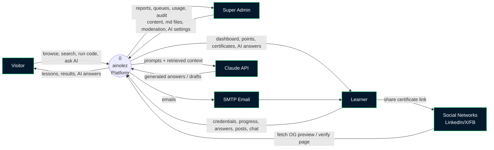

### 7.2 DFD Level 1
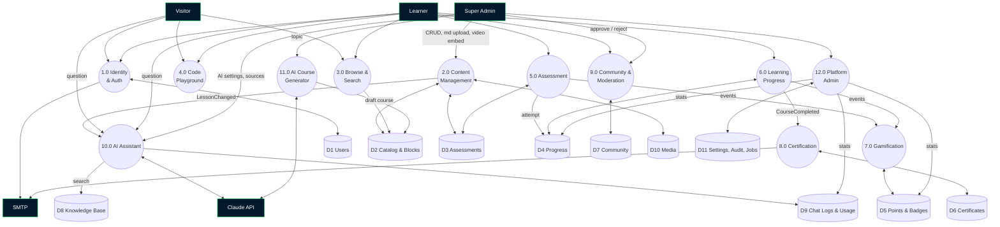

### 7.3 DFD Level 2 — 10.0 AI Assistant
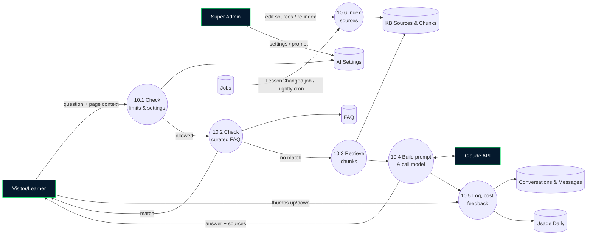

### 7.4 DFD Level 2 — 6.0 to 8.0 Learning, Points & Certificate
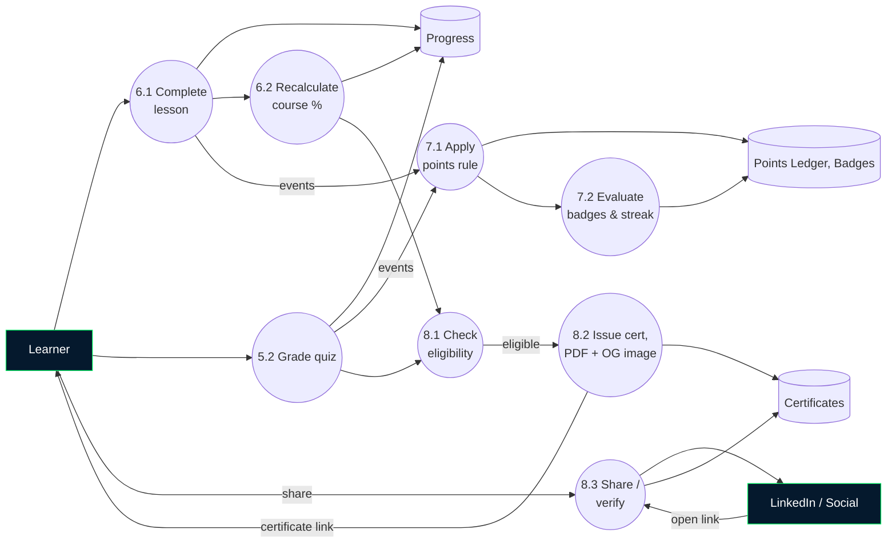

---

## 8. UML Diagrams

### 8.1 Use Case
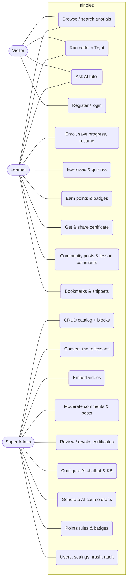

### 8.2 Class Diagram (main domain)
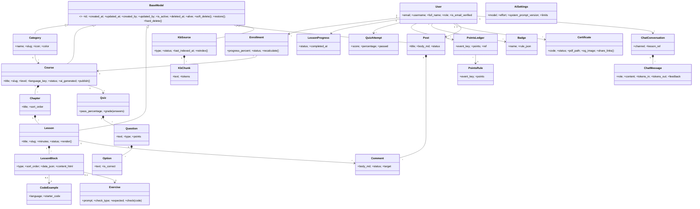

### 8.3 Sequence — AI Tutor Answer
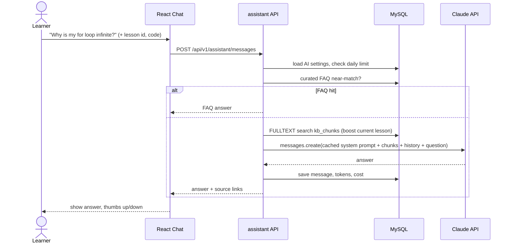

### 8.4 Sequence — Course Completion → Certificate → LinkedIn
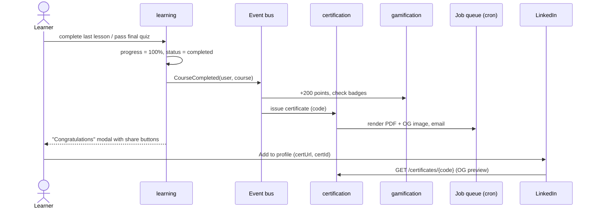

### 8.5 Activity — Admin imports .md into lessons
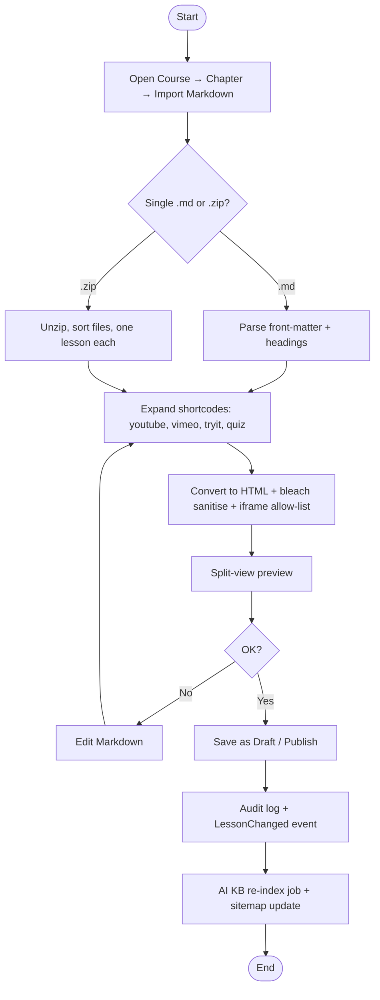

### 8.6 State Machine — Content & Moderation
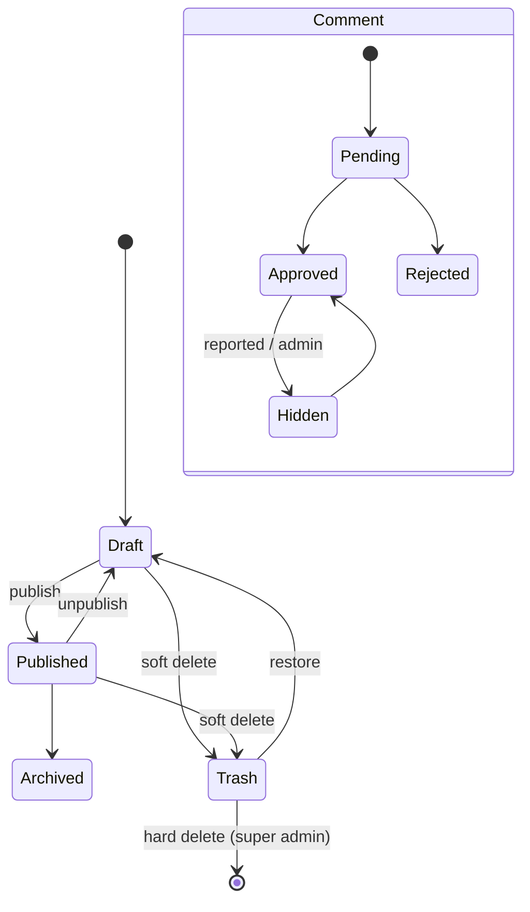

### 8.7 Component Diagram (modular monolith)
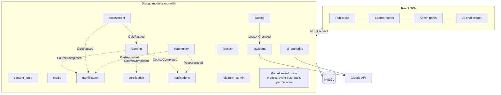

### 8.8 Deployment (cPanel)
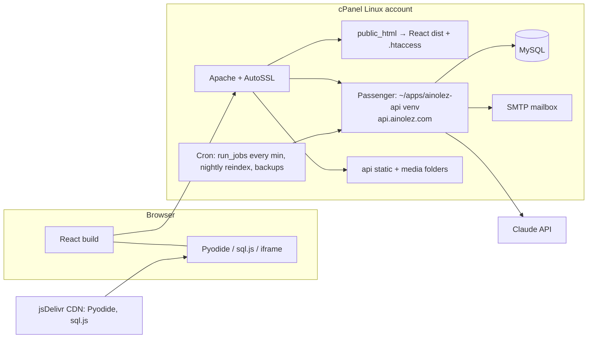

---

## 9. Database Design (MySQL 8, InnoDB, utf8mb4_unicode_ci)

**Common columns (from BaseModel), on every manageable table:**
`id BIGINT UNSIGNED PK`, `created_at`, `updated_at`, `created_by FK users NULL`, `updated_by FK users NULL`, `is_active TINYINT(1) DEFAULT 1`, `deleted_at DATETIME NULL`, `deleted_by FK NULL`, `alive TINYINT NULL DEFAULT 1`.

Log and ledger tables (`audit_logs`, `points_ledger`, `chat_messages`, `ai_usage_daily`, `jobs`) are append-only and have only `id` and `created_at`.

### 9.1 ER Diagram
```mermaid
erDiagram
  roles ||--o{ users : has
  users ||--o{ auth_tokens : owns
  users ||--|| learner_stats : has
  categories ||--o{ courses : groups
  courses ||--o{ chapters : contains
  chapters ||--o{ lessons : contains
  lessons ||--o{ lesson_blocks : ordered
  lesson_blocks }o--o| code_examples : uses
  lesson_blocks }o--o| exercises : uses
  lesson_blocks }o--o| media_files : uses
  courses ||--o{ quizzes : has
  quizzes ||--o{ quiz_questions : has
  quiz_questions ||--o{ quiz_options : has
  learning_paths ||--o{ learning_path_courses : includes
  courses ||--o{ learning_path_courses : in
  users ||--o{ enrollments : makes
  courses ||--o{ enrollments : receives
  users ||--o{ lesson_progress : tracks
  users ||--o{ quiz_attempts : takes
  quiz_attempts ||--o{ attempt_answers : contains
  users ||--o{ exercise_submissions : submits
  points_rules ||--o{ points_ledger : applies
  users ||--o{ points_ledger : earns
  badges ||--o{ user_badges : awarded
  users ||--o{ user_badges : holds
  certificate_templates ||--o{ certificates : renders
  users ||--o{ certificates : earns
  courses ||--o{ certificates : awards
  community_spaces ||--o{ community_posts : contains
  users ||--o{ community_posts : writes
  community_posts ||--o{ community_replies : has
  lessons ||--o{ lesson_comments : has
  users ||--o{ lesson_comments : writes
  users ||--o{ reactions : gives
  users ||--o{ content_reports : files
  users ||--o{ bookmarks : saves
  users ||--o{ snippets : writes
  kb_sources ||--o{ kb_chunks : split_into
  users ||--o{ chat_conversations : starts
  chat_conversations ||--o{ chat_messages : has
  ai_prompt_versions ||--o{ chat_messages : used_by
  ai_course_jobs ||--o{ courses : drafts
  users ||--o{ notifications : receives
  users ||--o{ audit_logs : performs
```

### 9.2 Tables by module

**identity**
| Table | Key columns | Constraints |
|---|---|---|
| roles | name (`super_admin`, `learner`), description | UNIQUE(name, alive) |
| users | role_id, email, username, password, full_name, avatar_url, bio, country, headline, is_email_verified, last_login_at, is_banned, ban_reason, show_on_leaderboard, public_profile | UNIQUE(email, alive), UNIQUE(username, alive) |
| auth_tokens | user_id, token_hash CHAR(64), type ENUM(verify_email, reset_password), expires_at, used_at | UNIQUE(token_hash) |

**catalog / media**
| Table | Key columns | Constraints |
|---|---|---|
| categories | name, slug, description, icon, color, sort_order | UNIQUE(slug, alive) |
| courses | category_id, title, slug, short_description, description, level ENUM, language_key, thumbnail_media_id, estimated_minutes, status ENUM(draft, published, archived), pass_rule JSON, ai_generated TINYINT, ai_course_job_id NULL, published_at | UNIQUE(slug, alive), IDX(category_id, status) |
| chapters | course_id, title, description, sort_order | IDX(course_id, sort_order) |
| lessons | chapter_id, title, slug, summary, estimated_minutes, status, sort_order, source_md LONGTEXT (original import), seo_title, seo_description | UNIQUE(chapter_id, slug, alive), FULLTEXT(title, summary) |
| lesson_blocks | lesson_id, type ENUM(markdown, example, video, callout, image, exercise, quiz, embed), sort_order, content_md LONGTEXT, content_html LONGTEXT, data JSON (video provider/id/start, callout kind, embed url), code_example_id NULL, exercise_id NULL, quiz_id NULL, media_id NULL | IDX(lesson_id, sort_order), FULLTEXT(content_md) |
| code_examples | title, language, starter_code MEDIUMTEXT, run_mode ENUM(iframe, pyodide, sqljs) | – |
| media_files | file_path, original_name, mime_type, size_bytes, width, height, alt_text | IDX(created_by) |
| learning_paths | title, slug, description, level | UNIQUE(slug, alive) |
| learning_path_courses | path_id, course_id, sort_order | UNIQUE(path_id, course_id) |

**assessment**
| Table | Key columns |
|---|---|
| exercises | lesson_id NULL, title, prompt, language, starter_code, solution_code, check_type ENUM(exact, contains, regex, output, tests), expected_value, test_code, hint, points_override |
| quizzes | course_id, chapter_id NULL, title, is_final, pass_percentage, time_limit_min, shuffle, max_attempts NULL, status |
| quiz_questions | quiz_id, question_text, question_type ENUM(single, multiple, true_false, code_output), code_snippet, explanation, points, sort_order |
| quiz_options | question_id, option_text, is_correct, sort_order |

**learning**
| Table | Key columns | Constraints |
|---|---|---|
| enrollments | user_id, course_id, status ENUM(active, completed), progress_percent, last_lesson_id, started_at, completed_at | UNIQUE(user_id, course_id) |
| lesson_progress | user_id, lesson_id, status ENUM(started, completed), seconds_spent, completed_at | UNIQUE(user_id, lesson_id) |
| exercise_submissions | user_id, exercise_id, submitted_code, is_correct, created_at | IDX(user_id, exercise_id) |
| quiz_attempts | user_id, quiz_id, score, total_points, percentage, passed, started_at, submitted_at | IDX(user_id, quiz_id) |
| attempt_answers | attempt_id, question_id, selected_option_ids JSON, is_correct | IDX(attempt_id) |
| bookmarks | user_id, lesson_id | UNIQUE(user_id, lesson_id) |
| snippets | user_id, title, language, code, is_public, share_slug | UNIQUE(share_slug) |

**gamification**
| Table | Key columns | Constraints |
|---|---|---|
| points_rules | event_key (lesson_completed, quiz_passed, …), points, daily_cap NULL, description | UNIQUE(event_key, alive) |
| points_ledger | user_id, rule_id, event_key, points, ref_type, ref_id, created_at | UNIQUE(user_id, event_key, ref_type, ref_id) (no double award) |
| learner_stats | user_id PK, total_points, weekly_points, current_streak, longest_streak, last_active_date, lessons_completed, courses_completed | IDX(total_points), IDX(weekly_points) |
| badges | name, slug, description, icon_media_id, rule JSON (type, threshold) | UNIQUE(slug, alive) |
| user_badges | user_id, badge_id, awarded_at | UNIQUE(user_id, badge_id) |

**certification**
| Table | Key columns | Constraints |
|---|---|---|
| certificate_templates | name, layout JSON, colors JSON, signature_media_id, signer_name, is_default | – |
| certificates | user_id, course_id, template_id, certificate_code CHAR(12), status ENUM(pending_review, issued, revoked), pdf_path, og_image_path, issued_at, revoked_at, revoke_reason, share_count, view_count | UNIQUE(certificate_code), UNIQUE(user_id, course_id, alive) |

**community**
| Table | Key columns |
|---|---|
| community_spaces | name, slug, description, icon, sort_order, posting_rule ENUM(open, approval_required) |
| community_posts | space_id, user_id, title, body_md, body_html, status ENUM(pending, approved, rejected, hidden), is_pinned, is_locked, accepted_reply_id, reply_count, reaction_count, ai_flag ENUM(none, spam, toxic) — FULLTEXT(title, body_md) |
| community_replies | post_id, user_id, parent_reply_id NULL, body_md, body_html, status, is_helpful |
| lesson_comments | lesson_id, user_id, parent_id NULL, body_md, body_html, status ENUM(pending, approved, rejected, hidden) |
| reactions | user_id, target_type ENUM(post, reply, comment), target_id, type ENUM(like, helpful) — UNIQUE(user_id, target_type, target_id, type) |
| content_reports | reporter_id, target_type, target_id, reason, status ENUM(open, resolved, dismissed), resolved_by, resolution_note |
| moderation_actions | moderator_id, target_type, target_id, action ENUM(approve, reject, hide, pin, lock, warn, ban), reason |

**assistant (AI chatbot)**
| Table | Key columns |
|---|---|
| ai_settings | singleton: enabled, enabled_for_visitors, enabled_for_learners, bot_name, avatar_media_id, welcome_message, starter_questions JSON, model, effort, max_output_tokens, active_prompt_version_id, visitor_daily_limit, learner_daily_limit, monthly_token_budget, log_retention_days, hint_only_in_quiz |
| ai_prompt_versions | version_no, system_prompt TEXT, notes, is_current |
| ai_faq | question, answer_md, keywords, priority — FULLTEXT(question, keywords) |
| kb_sources | type ENUM(lesson, course, faq, document, url), ref_type, ref_id, title, url, file_media_id, status ENUM(pending, indexed, failed), last_indexed_at, chunk_count, content_hash |
| kb_chunks | source_id, chunk_no, text MEDIUMTEXT, tokens, embedding JSON NULL (future), lesson_id NULL, course_id NULL — FULLTEXT(text), IDX(source_id) |
| chat_conversations | user_id NULL, session_key (visitors), channel ENUM(widget, lesson, page), lesson_id NULL, title |
| chat_messages | conversation_id, role ENUM(user, assistant), content, source_chunk_ids JSON, model, prompt_version_id, tokens_in, tokens_out, cached_tokens, latency_ms, feedback ENUM(up, down) NULL, flagged, created_at |
| ai_usage_daily | date, model, audience ENUM(visitor, learner, admin), requests, tokens_in, tokens_out, est_cost — UNIQUE(date, model, audience) |

**ai_authoring**
| Table | Key columns |
|---|---|
| ai_course_jobs | requested_by, topic, level, audience, chapters_count, outline JSON, status ENUM(outline_ready, generating, drafted, failed), course_id NULL, tokens_used, error |

**notifications / platform_admin**
| Table | Key columns |
|---|---|
| notifications | user_id, type, title, body, link, read_at |
| email_templates | key, subject, body_html |
| site_settings | key (PK), value JSON, updated_by |
| audit_logs | user_id, action, entity_type, entity_id, before JSON, after JSON, ip_address, created_at — IDX(entity_type, entity_id) |
| jobs | type, payload JSON, status ENUM(queued, running, done, failed), attempts, run_after, last_error, created_at — IDX(status, run_after) |

**Foreign-key policy:**
- `CASCADE` from parent to child content (course → chapters → lessons → blocks; quiz → questions → options).
- `RESTRICT` for anything that refers to users and for certificates' link to courses.
- A hard delete runs the cascade only after the confirmation preview.

---

## 10. API Overview (`/api/v1`)
- `auth/` — register, verify, login, refresh, logout, forgot, reset, me.
- `public/` — categories, paths, courses, lessons, search, certificates/verify/{code}, snippets/{slug}, community (read), leaderboard.
- `learner/` — enrolments, progress, lesson-complete, quizzes, attempts, exercises/submit, bookmarks, snippets, points, badges, certificates, community (write), comments, notifications.
- `assistant/` — conversations, messages, feedback.
- `admin/<module>/<resource>/` — the standard set of endpoints for every resource:
  - `GET` list (with filters `?status=&active=&deleted=`)
  - `POST` create
  - `GET`/`PATCH` detail
  - `POST {id}/activate|deactivate|soft-delete|restore`
  - `DELETE {id}/hard` (super admin, with a confirm token)
  - `POST bulk/`
- Admin extras:
  - `content-tools/md-convert`, `content-tools/md-import`
  - `assistant/settings|sources|reindex|faq|conversations|usage`
  - `ai-authoring/jobs`
  - `moderation/queue`
  - `certificates/{id}/revoke|reissue`
  - `trash/`, `audit-logs/`, `jobs/`, `stats/`

---

## 11. Admin Control Panel — Menu
Dashboard · **Catalog** (Categories, Courses, Chapters, Lessons + block editor, Code Examples, Learning Paths) · **Assessments** (Exercises, Quizzes) · **Content Tools** (Markdown import/convert, Video embeds) · **Media** · **Community** (Spaces, Moderation queue, Reports, Lesson comments) · **Certificates** (Issued, Pending review, Templates) · **Gamification** (Points rules, Badges, Leaderboard) · **AI** (Chatbot settings, Prompt versions, Knowledge base, FAQ, Conversations, Usage, Course generator) · **Users** · **Settings** (Site, Email, SEO, Moderation policy) · **Trash** · **Audit log** · **Jobs**

The dashboard shows:
- New learners, active today, and lessons completed.
- Certificates issued and AI questions, plus AI cost this month.
- Pending moderation, top courses, and failed jobs.

---

## 12. cPanel Deployment Plan (item 14)

**12.1 Hosting requirements (check before buying or using a plan):**
- cPanel with **"Setup Python App"** (CloudLinux Passenger) and Python ≥ 3.11.
- MySQL 8 / MariaDB ≥ 10.6.
- **SSH access** (strongly preferred) and **Cron Jobs**.
- **Git™ Version Control**, or SSH plus `git`.
- AutoSSL, and at least 2 GB disk to start.
- Outbound HTTPS allowed, which the Claude API needs.

**12.2 Layout**
```
/home/<user>/
  apps/ainolez-api/          Django code (NOT web-accessible)
    .env                     secrets (DB, SECRET_KEY, ANTHROPIC_API_KEY, SMTP) chmod 600
    passenger_wsgi.py
    tmp/restart.txt
  virtualenv/apps/ainolez-api/3.11/   created by cPanel Python App
  public_html/               React dist + .htaccess (SPA fallback, cache headers, security headers)
  api.ainolez.com/           doc root for API subdomain: static/ media/ (+ Passenger app mounted here)
  backups/                   nightly mysqldump (rotated 7 days)
  logs/
```

**12.3 Code rules that keep it cPanel-friendly:**
- WSGI only. No ASGI, websockets, Redis, or Celery.
- Long tasks (AI generation, PDF rendering, re-indexing, emails) go into the `jobs` table. Cron runs `python manage.py run_jobs --max-seconds 50` **every minute**, with a lock file so runs don't overlap.
- Any API request that could take long returns quickly with a job id; the frontend polls for the result.
- All config comes from `.env` through `django-environ`. No hard-coded paths. `ALLOWED_HOSTS`, `CORS_ALLOWED_ORIGINS`, and `CSRF_TRUSTED_ORIGINS` are environment variables.
- Static files use `collectstatic` (served by Apache, with WhiteNoise as a fallback). Media goes to a web-served folder with upload type and size limits.
- Pure-Python fallbacks for libraries that need compiling (PyMySQL if `mysqlclient` fails to build).
- Memory-aware: Pyodide and sql.js run in the browser; the server only queries the database and calls the AI API.
- Settings modules `local.py` and `production.py`. `DEBUG=False` in production, secure cookies, HSTS.

**12.4 Deploy pipeline**
1. **GitHub Actions on every push to `main`:**
   - Lint and test the backend and frontend.
   - Build React (`npm run build`).
   - Upload `dist/` to `public_html` by SSH/rsync (or FTP deploy if there's no SSH).
2. **Backend:** use either cPanel Git Version Control with `.cpanel.yml`, or SSH. The deploy script:
   - `git pull`
   - `source venv/bin/activate && pip install -r requirements/prod.txt`
   - `python manage.py migrate --noinput && python manage.py collectstatic --noinput`
   - `touch tmp/restart.txt`
3. **Cron jobs:**
   - Every minute: `run_jobs`.
   - 02:00: `reindex_kb --changed`.
   - 02:30: `rebuild_sitemap`.
   - 03:00: `mysqldump` backup.
   - Weekly: `cleanup_tokens` and log purge.
4. **Staging:** `staging.ainolez.com` plus a separate database, deployed from the `develop` branch.
5. **Rollback:** keep the previous release folder plus a database dump taken before migrating; switch with a symlink.

---

## 13. Sprint Plan — 5 sprints × 2 weeks (about 10 weeks)

| Sprint | Goal | Main deliverables | Done when |
|---|---|---|---|
| **S1: Foundation & Brand** | Skeleton live on staging | Logo set and design tokens; React shell (public, learner, and admin layouts); Django modular-monolith skeleton plus the `shared` kernel (BaseModel, soft delete, audit, event bus, jobs + cron); identity (register, verify, login, JWT, reset); CI; **cPanel staging deploy** | A learner signs up and logs in, the admin sees an empty panel, cron runs jobs |
| **S2: Dynamic CMS & Content Tools** | Admin builds everything, public reads it | Full CRUD with the universal controls for categories, courses, chapters, lessons, blocks, examples, media, learning paths; drag-order blocks; **.md/.zip import + converter + video embeds**; Trash & hard delete; public home, course, and lesson pages (W3 style), search | The admin imports a Markdown chapter with a YouTube video, publishes it, and a visitor reads it |
| **S3: Learning, Assessment, Points & Certificates** | Full learning loop | Try-it editor (iframe, Pyodide, sql.js); exercises with auto-check; quiz builder and taker; enrolment, progress, resume; **points rules, ledger, badges, streaks, leaderboard**; **auto certificate** (PDF + OG image + verify page + LinkedIn/social share); certificate review page; learner dashboard | A learner finishes a course, gains points, and adds the certificate to LinkedIn |
| **S4: Community & AI Tutor** | Social learning + AI | Spaces, posts, replies, lesson comments, reactions, reports, **moderation queue**; **AI chatbot** (widget, lesson-aware, FAQ, RAG over MySQL FULLTEXT); auto re-index on events + nightly; **AI control panel** (model, prompt versions, KB, limits, logs, usage) | A learner asks the AI about the current lesson and gets a cited answer. The admin edits a lesson and the bot reflects it after re-indexing. Comments wait for approval |
| **S5: AI Course Generator, Seed Content, Hardening & Launch** | Production launch | **AI course generator** → generate and review the Python and AI catalog (§6.7) plus web basics; admin analytics; SEO (prerendered public pages, meta/OG, sitemap); security pass (rate limits, CSP, sandbox, CORS); performance; backups; **production deploy** | At least 10 published courses. Smoke tests pass on production. Lighthouse ≥ 90 |

---

## 14. More Plans & Ideas (items 6 and 15)

**Recommended next (after launch):**
1. **Learning paths / career tracks:** "Python Developer", "Data Analyst", "AI Engineer". The path certificate is earned by completing all courses in the path.
2. **Placement test:** a 10-question quiz suggests the right starting course.
3. **Daily challenge:** one small coding problem a day, with streak points.
4. **Spaced-repetition review:** missed quiz questions come back in a "Review" deck.
5. **AI code reviewer in the editor:** an "Explain my error" or "Review my code" button that sends the Try-it code to the AI tutor.
6. **Project-based lessons:** multi-step guided projects (build a portfolio site, a to-do app, a data dashboard).
7. **Public learner profile / portfolio:** points, badges, certificates, and shared snippets in one shareable page.
8. **PWA + offline reading:** installable app with cached lessons.
9. **Dark mode and accessibility (WCAG 2.1 AA):** keyboard navigation, screen reader labels.
10. **Multi-language UI and content:** i18n-ready from Sprint 1 so it's cheap later.
11. **Interview prep and cheat sheets:** printable one-page references per language.
12. **Notification centre plus weekly email digest:** "You're 2 lessons from your certificate".

**Later:**
- Instructor / content-editor role, so non-super-admins can create content with approval.
- Live events and webinars.
- A mobile app using the same API.
- An optional donation or sponsor page (not a purchase).
- A public API.

**Good practices I'd add from day one:**
- **Human review of all AI-generated content.** Mark AI-authored lessons internally and keep a "Report an error" button on every lesson.
- **AI cost guardrails:**
  - A monthly budget with auto-pause.
  - FAQ answers served first, so frequent questions cost nothing.
  - Prompt caching.
  - Per-user daily limits.
- **Privacy:** visitor chats are linked only to an anonymous session key, and logs are purged after the retention period.
- **SEO** is the biggest free growth channel for a W3Schools-style site. Prerender public lesson pages and give every lesson a clean URL like `/python/lists`.
- **Analytics** without cookies: a self-hosted, privacy-friendly option such as Plausible or Umami if the host allows it, or simple server-side counters.

---

## 15. Verification Plan
- **Unit tests per module:**
  - services such as `grade_quiz`, `apply_points_rule` (no double award), `issue_certificate`, `soft_delete` / `restore` / `hard_delete`, and the md converter (shortcodes, sanitising);
  - the AI retrieval ranking.
- **Boundary test:** `import-linter` fails the build on any cross-module model import.
- **API permission tests:** a learner gets 403 on every `admin/*` endpoint; a hard delete is refused for anyone but the super admin.
- **End-to-end on staging:** import `.md` → publish → AI answers about it → learner completes → points → certificate → LinkedIn share preview renders → admin revokes → verify page shows revoked.
- **Deploy checks:** Passenger restart, deep links through `.htaccess`, cron running jobs, backups present, HTTPS everywhere.
